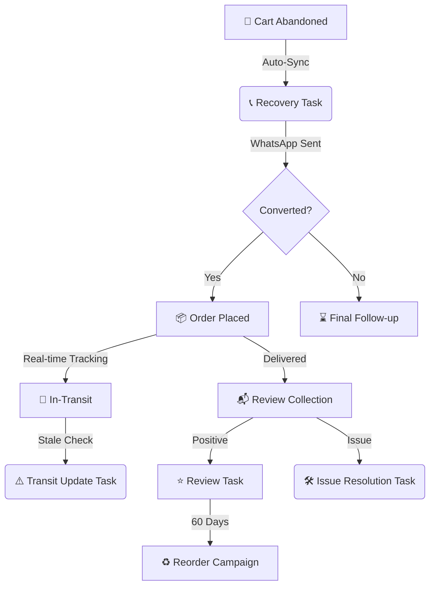

# 🌌 CureForever CRM: Master Roadmap & Strategy

Welcome to **Mission Control** for CureForever. This document is the definitive guide for **Admins** and **Agents** to understand the system architecture, its current automated power, and the vision for our scale.

---

## 🧭 The Core Mission
The CureForever CRM is built to maximize **Customer Lifetime Value (LTV)** and minimize **Revenue Loss (RTO)** through high-fidelity automation. We bridge the gap between **Shopify** (Sales Authority), **Shiprocket** (Logistics Authority), and **WhatsApp** (Engagement Authority).

### 🔄 The Automated Customer Lifecycle

---

## 👑 Admin Control Center (Strategy & Oversight)

Admins steer the CRM’s logic and monitor the health of the entire automation engine.

### ⚙️ Automation & Infrastructure
- **Self-Healing Tokens**: The CRM automatically refreshes Shopify API tokens every 24 hours, ensuring 100% uptime with zero manual intervention.
- **Fastrr/Shiprocket Webhooks**: We receive real-time updates from Fastrr Checkout. Every abandoned cart or delivery event hits the CRM in milliseconds.
- **Workflow Orchestration**: Admins can configure "Wait Rooms" (delays) and message templates to fine-tune customer engagement.

### 📊 Business Intelligence
- **Real-time KPI Dashboard**: Monitor RTO% (Return to Origin), Recovery Conversion, and Daily Revenue snapshots.
- **Customer Health Scores**: Automated segmentation identifying VIPs (High LTV) and Risky customers (Chronic RTO behavior).

---

## 🎧 Agent Command (Daily Operations)

Agents are the "Last Mile" of customer engagement, focusing on high-impact calls and issue resolution.

### 📋 The Intelligent Task Engine
Tasks are not created equal. Our engine automatically prioritizes your day using a **Weighted Priority Score**:
- **Issue Resolution (Weight: 120)**: Problems during delivery. Must be solved instantly to prevent RTO.
- **Recovery (Weight: 80)**: Capturing abandoned carts from today.
- **Reorder (Weight: 50)**: Re-engaging past happy customers.

### 🕵️ Identity & Unmasking
- **Phone Unmasking**: No more "masked" numbers. The CRM automatically resolves hidden Shiprocket numbers into real contact info before you even click the task.
- **Call History**: Every touchpoint (WhatsApp, Call log, Note) is consolidated into one 360-degree timeline.

---

## 📅 Roadmap: Past, Present, Future

### ✅ Milestone 1: The Foundation (COMPLETED)
- Full Shopify & Shiprocket API parity.
- Automated Task Generation Engine.
- WhatsApp Integration & Template server.
- Secure Agent Profile & Role management.

### 🚀 Milestone 2: Intelligent Hardening (CURRENT)
- **Fastrr Checkout Sync**: Automated real-time cart capture.
- **Transit Inform Pipeline**: Proactive alerts for delayed or undelivered shipments.
- **Auto-Assignment Logic**: Efficient task distribution based on agent workload and presence.
- **Dynamic Settings UI**: Real-time configuration of delays and API credentials.

### 🔜 Milestone 3: Scale & Intelligence (FUTURE)
- **Omnichannel Expansion**: SMS and Email fallback for customers not on WhatsApp.
- **AI Sentiment Analysis**: Automated detection of customer mood during chat to trigger manager alerts.
- **Financial Heatmaps**: Deep reporting on ROI per campaign/agent.
- **Interactive Calendar View**: Visual drag-and-drop for follow-up scheduling.

---

> [!TIP]
> **Admins**: Visit the **Settings** tab to fine-tune your `Recovery Delay Hours`. Lowering this creates a sense of urgency for carts, while increasing it gives customers space.
> 
> **Agents**: Always check the **Priority Score** on your dashboard. High scores (150+) mean the customer is a VIP or has a time-sensitive delivery issue!
