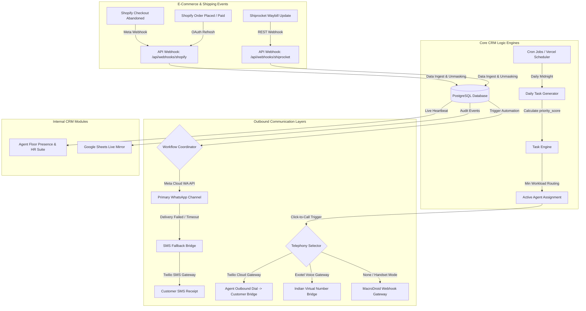
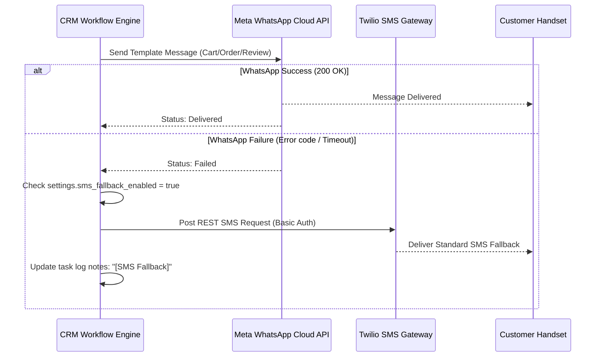

# CureForever CRM: Master Technical & System Documentation
*Version 3.0.0 (Omnichannel Telephony & Intelligent Fallback Production Release)*

---

## 1. Executive Summary

**CureForever CRM** is an enterprise-grade, task-centric e-commerce operations platform designed specifically for high-growth wellness, nutraceutical, and Direct-to-Consumer (DTC) brands in the Indian market. Unlike generic pipeline-style CRMs, CureForever is custom-engineered to automate and manage **post-purchase operations** at scale. By bridging Shopify order profiles, Shiprocket logistics tracking, active cloud telephony networks, and multi-layered automated WhatsApp/SMS communications into a unified agent workflow, the platform maximizes customer retention, recovers abandoned checkouts, coordinates Non-Delivery Reports (NDR), and streamlines team operations.

---

## 2. Integrated System Architecture

The following diagram maps the high-fidelity flow of events, background cron processes, self-healing queues, and communication channels:



---

## 3. Core Modules Deep-Dive

### Module A: The Executive Dashboard (`/dashboard`)
The command center loads global operational KPIs in real-time, pulling aggregated data from tasks, orders, checkouts, and agent tracking.

#### Visual Wireframe Blueprint
```
+-----------------------------------------------------------------------------------+
|  [CUREFOREVER CRM]  Dashboard  Tasks  Carts  HR  Chat  Settings      [Agent Info] |
+-----------------------------------------------------------------------------------+
|  DAILY PERFORMANCE OVERVIEW                                                       |
|  +-------------------+  +-------------------+  +-------------------+  +---------+ |
|  | PENDING TASKS     |  | OVERDUE (4-DAYS)  |  | RECOVERED REVENUE |  | STATUS  | |
|  | 42 Tasks          |  | 8 Urgent          |  | ₹1,42,850         |  | ONLINE  | |
|  +-------------------+  +-------------------+  +-------------------+  +---------+ |
|                                                                                   |
|  REAL-TIME LOGISTICS & TELEPHONY ENGAGEMENT                                       |
|  +--------------------------------------------+  +------------------------------+ |
|  | OUTSTANDING WORKLOAD BY TYPE (RECHARTS)    |  | TOP PERFORMING AGENTS        | |
|  |   [Issue Resolution] ================== 40%|  | 1. Rajesh Kumar (98% Done)   | |
|  |   [Abandoned Cart]   ============ 30%      |  | 2. Priya Sharma (95% Done)   | |
|  |   [COD Verification] ========= 20%         |  | 3. Amit Singh   (92% Done)   | |
|  +--------------------------------------------+  +------------------------------+ |
+-----------------------------------------------------------------------------------+
```

- **Metrics Calculation**:
  - *Recovered Revenue*: Aggregated total order price of converted carts tracked via `/api/webhooks/shopify` matching active `recovery` tasks.
  - *Overdue Guardrails*: Limits long-running database scans by querying only the past 4 days of pending tasks to optimize render speeds.

---

### Module B: The Intelligent Task Engine (`/tasks`)
Tasks represent the core operational unit. Every customer touchpoint is calculated, structured, and routed dynamically.

#### Priority Scoring Algorithm (`src/lib/task-engine.ts`)
The priority score determines the order in which tasks appear on an agent's screen:
$$\text{Score} = \text{Base Weight} + \text{Price Weight} + \text{Loyalty Bonus} + \text{Segment Modifier} + \text{Urgency Weight} - \text{RTO Penalty}$$

| Factor | Calculation Logic |
| :--- | :--- |
| **Base Weight** | `issue_resolution`: 120, `recovery`: 80, `cod_verify`: 75, `ndr`: 70, `transit_update`: 60, `review`: 50, `reorder`: 40, `final_followup`: 30 |
| **Price Weight** | Value $\ge 5000$: +40 \| Value $\ge 3000$: +25 \| Value $\ge 1500$: +15 |
| **Loyalty Bonus** | Customer Orders $\ge 5$: +30 \| Orders $\ge 2$: +15 |
| **Segment Modifier** | `risky`: +20 (high urgency) \| `repeat`: +10 |
| **Urgency Weight** | `overdueDays` $\times$ 6 (capped at maximum +45) |
| **RTO Penalty** | -15 for `risky` segment (applied to all tasks except `issue_resolution` to shield agent bandwidth) |

#### Specialization-Based Workload Assignment
1. Scans for active agent profiles (`profiles.is_active = true` and presence status is not `offline`).
2. Filters eligible agents by comparing the task's segment and type against `assigned_segments` and `assigned_task_types` arrays.
3. Groups available candidates by network latency (Online $\le 5$ min, Recent $\le 1$ hour).
4. Routes the task to the agent holding the absolute lowest volume of active pending tasks.

---

### Module C: Omnichannel Cloud Telephony Gateway (`src/components/ClickToCallModal.tsx`)
Launched in Milestone 3, this system integrates cloud telephony gateways with manual mobile integrations to enable outbound calls with real-time logging.

```
                  +----------------------------------------+
                  |           CLOUD CLICK-TO-CALL          |
                  +----------------------------------------+
                  | Call Recipient: Ramesh Patel           |
                  | Customer Phone: +919876543210          |
                  |                                        |
                  | [x] Use Twilio Voice Cloud             |
                  |                                        |
                  | Input Agent Forwarding Number:         |
                  | [ +91 99887 76655                 ]    |
                  |                                        |
                  |   [ Direct Dialer ]   [ CALL VIA CLOUD ] |
                  +----------------------------------------+
```

- **Twilio Voice REST Integration** (`src/app/api/telephony/call/route.ts`):
  Initiates a server-side call using Basic Authentication to Twilio Voice endpoints. The parameters include the agent's forwarding number, caller ID, and a self-contained TwiML script instructing Twilio to dial the agent first, and bridge the customer instantly upon answer:
  ```xml
  <Response>
    <Dial callerId="+1XXXYYYZZZZ">
      <Number>+919876543210</Number>
    </Dial>
  </Response>
  ```
- **Exotel Connect Voice Gateway**:
  Triggers Exotel's server-to-server outbound bridge using Exotel SID, token, and virtual numbers.
- **Android Handset MacroDroid Webhook Receiver**:
  Generates manual dial requests broadcasted to agent mobile handsets running MacroDroid receivers for zero-cost, localized calling.

---

### Module D: WhatsApp & Twilio SMS Fallback Bridge
High-throughput post-purchase communications must hit near-100% receipt rates. If Meta's WhatsApp Cloud API rejects a template delivery or reports a template failure, the system falls back to SMS.



* **WhatsApp Secondary Endpoint**: Integrates a local `wa_server.js` using `whatsapp-web.js` for localized, zero-cost fallback broadcasts over standard scanned QR sessions.

---

### Module E: Automated E-Commerce & Logistics Sync
Pipes data dynamically from Shopify checkout processes and Shiprocket logistics.

- **OAuth Credentials Management**:
  Configured a self-healing auto-refresh endpoint. If a webhook or sync reports a `401 Unauthorized` token, it reads the encrypted `shopify_refresh_token` from the database, triggers the token endpoint with Client ID and Secret credentials, saves the fresh token back to settings, and retries the sync process.
- **Fastrr Checkouts & Webhooks** (`src/app/api/webhooks/shopify/route.ts`):
  Decodes cart abandonment payloads. If an uncompleted checkout token is captured, it schedules a `recovery` task in PostgreSQL exactly `settings.recovery_delay_hours` later.
- **Transit Inform Pipeline** (`src/app/api/cron/task-generator/route.ts`):
  Scans all active orders holding the `in_transit` state. If the shipment remains stuck in transit for 48+ hours, it cancels general follow-up sequences and creates an `issue_resolution` task assigned to the NDR logistics team.
- **Sentiment Protection Guardrail**:
  If a customer profile has a pending, open, or unresolved `issue_resolution` task (e.g. damaged package, missing refund, wrong shipment), the system immediately **suppresses all automatic reviews or reorder campaigns** to avoid brand damage.

---

### Module F: The Interactive Calendar Module (`/calendar`)
Provides agents and floor managers a clean calendar interface to organize task loads.

- **Visualizing Time & Work**: Displays color-coded task cards over a day, week, or month layout. Red marks high-priority tasks (e.g. `issue_resolution`, `recovery`), orange for standard `cod_verify` tasks, and cream/grey for routine follow-ups.
- **Quick-Action Panel**: Clicking on a scheduled calendar block slides in a panel where agents can complete, reschedule, or initiate click-to-call dialing instantly without losing their place on the calendar.

---

### Module G: The Indian Compliance HR & Payroll Suite (`/hr`)
Handles agent floor management and payroll operations according to Indian compliance standards.

#### Heartbeat Presence Monitor (`src/components/AgentHeartbeat.tsx`)
Updates agent activity status to the database every 60 seconds. If an agent goes idle or fails to send heartbeats, their status changes to offline, pausing task routing to their queue.

#### Financial Calculations & Tax Compliance Formulae
When a manager runs monthly payroll via the console, the system applies the following calculations:

```
                  +-----------------------------------------+
                  |         INDIAN COMPLIANCE PAYROLL       |
                  +-----------------------------------------+
                  | Gross Base Salary: ₹30,000              |
                  |                                         |
                  | Deductions:                             |
                  |   - Provident Fund (12%): ₹3,600        |
                  |   - Professional Tax (PT): ₹200         |
                  |   - TDS (Estimated Tax):  ₹1,500        |
                  |                                         |
                  | Net Pay Distributed: ₹24,700            |
                  +-----------------------------------------+
```

1. **Provident Fund (PF)**:
   $$\text{PF Deduction} = \text{Basic Salary} \times 12\%$$
   *(Under EPF Act, 1952, capped at a basic wage of ₹15,000 per month unless voluntary option is set).*
2. **Professional Tax (PT)**:
   Assesses professional taxes according to regional state slab structures:
   $$\text{PT} = \begin{cases} \text{₹200} & \text{Monthly Gross } \ge \text{₹10,000} \\ \text{₹0} & \text{Otherwise} \end{cases}$$
   *(Note: Maharashtra levies ₹250 in February, ₹200 in all other months).*
3. **Tax Deducted at Source (TDS)**:
   Dynamic calculation according to estimated income tax slabs or standard rates:
   $$\text{TDS} = \text{Gross Monthly Salary} \times \text{TDS Rate (e.g., 5\% or 10\% depending on PAN status)}$$

---

## 4. Comprehensive Database Schema Reference

A complete set of optimized PostgreSQL tables running under Supabase:

```
                                 [profiles]
                                     | (1)
                                     |
                                     | (many)
  [customers] (1)-----(many) [orders] (1)-----(many) [tasks] (1)-----(many) [call_logs]
       |                         |                      |
       | (1)                     | (1)                  | (1)
       |                         |                      |
       | (many)                  | (1)                  | (1)
  [abandoned_carts] ------------+                      +-- [raw_call_logs] (1:1)
```

### Table 1: `public.customers`
```sql
CREATE TABLE public.customers (
    id UUID PRIMARY KEY DEFAULT gen_random_uuid(),
    shopify_customer_id VARCHAR(100) UNIQUE,
    name TEXT NOT NULL,
    phone VARCHAR(50) NOT NULL,
    email TEXT,
    alt_phone VARCHAR(50) DEFAULT '',
    segment VARCHAR(50) DEFAULT 'one_time', -- repeat, one_time, inactive, risky
    rto_flag BOOLEAN DEFAULT false,
    rto_count INT DEFAULT 0,
    total_orders INT DEFAULT 0,
    last_order_date TIMESTAMP WITH TIME ZONE,
    whatsapp_reminders_enabled BOOLEAN DEFAULT true,
    created_at TIMESTAMP WITH TIME ZONE DEFAULT timezone('utc'::text, now()) NOT NULL
);
```

### Table 2: `public.orders`
```sql
CREATE TABLE public.orders (
    id UUID PRIMARY KEY DEFAULT gen_random_uuid(),
    customer_id UUID REFERENCES public.customers(id) ON DELETE CASCADE,
    shopify_order_id VARCHAR(100) UNIQUE,
    order_number VARCHAR(100) NOT NULL,
    line_items JSONB NOT NULL,
    total_price NUMERIC(12,2) NOT NULL,
    fulfillment_status VARCHAR(50) DEFAULT 'unfulfilled', -- unfulfilled, partial, fulfilled
    delivery_status VARCHAR(50) DEFAULT 'pending', -- pending, in_transit, out_for_delivery, delivered, rto, failed
    tracking_number VARCHAR(100) DEFAULT '',
    ordered_at TIMESTAMP WITH TIME ZONE NOT NULL,
    delivered_at TIMESTAMP WITH TIME ZONE,
    created_at TIMESTAMP WITH TIME ZONE DEFAULT timezone('utc'::text, now()) NOT NULL
);
```

### Table 3: `public.tasks`
```sql
CREATE TABLE public.tasks (
    id UUID PRIMARY KEY DEFAULT gen_random_uuid(),
    order_id UUID REFERENCES public.orders(id) ON DELETE CASCADE,
    customer_id UUID REFERENCES public.customers(id) ON DELETE CASCADE,
    abandoned_cart_id UUID REFERENCES public.abandoned_carts(id) ON DELETE SET NULL,
    assigned_to UUID REFERENCES public.profiles(id) ON DELETE SET NULL,
    task_type VARCHAR(50) NOT NULL, -- issue_resolution, recovery, cod_verify, review, reorder, etc.
    due_date TIMESTAMP WITH TIME ZONE NOT NULL,
    priority_score INT DEFAULT 0,
    status VARCHAR(50) DEFAULT 'pending', -- pending, due, done, rescheduled, skipped, cancelled, overdue
    call_attempt_count INT DEFAULT 0,
    next_attempt_at TIMESTAMP WITH TIME ZONE,
    completed_at TIMESTAMP WITH TIME ZONE,
    rescheduled_to TIMESTAMP WITH TIME ZONE,
    notes TEXT DEFAULT '',
    created_at TIMESTAMP WITH TIME ZONE DEFAULT timezone('utc'::text, now()) NOT NULL
);
```

### Table 4: `public.settings`
```sql
CREATE TABLE public.settings (
    id UUID PRIMARY KEY,
    review_offset_days INT DEFAULT 5,
    reorder_offset_days INT DEFAULT 20,
    final_offset_days INT DEFAULT 30,
    inactive_threshold_days INT DEFAULT 45,
    recovery_delay_hours INT DEFAULT 24,
    
    -- WhatsApp Credentials
    whatsapp_app_id VARCHAR(255) DEFAULT '',
    whatsapp_app_secret VARCHAR(255) DEFAULT '',
    whatsapp_phone_id VARCHAR(255) DEFAULT '',
    whatsapp_token VARCHAR(255) DEFAULT '',
    
    -- Telephony Credentials (Milestone 3)
    telephony_provider VARCHAR(50) DEFAULT 'none',
    twilio_account_sid VARCHAR(255) DEFAULT '',
    twilio_auth_token VARCHAR(255) DEFAULT '',
    twilio_caller_id VARCHAR(50) DEFAULT '',
    exotel_sid VARCHAR(255) DEFAULT '',
    exotel_token VARCHAR(255) DEFAULT '',
    exotel_caller_id VARCHAR(50) DEFAULT '',
    
    -- SMS Fallback Credentials (Milestone 3)
    sms_fallback_enabled BOOLEAN DEFAULT false,
    sms_provider VARCHAR(50) DEFAULT 'twilio',
    sms_twilio_sid VARCHAR(255) DEFAULT '',
    sms_twilio_token VARCHAR(255) DEFAULT '',
    sms_twilio_number VARCHAR(50) DEFAULT ''
);
```

---

## 5. System Setup & Compilation Guide

### Local Environment Setup
To spin up the environment locally, configure the following keys in your `.env.local` file:
```env
NEXT_PUBLIC_SUPABASE_URL=https://your-project-id.supabase.co
NEXT_PUBLIC_SUPABASE_ANON_KEY=eyJhbGciOiJIUzI1NiIsInR5cCI6IkpXVCJ9...
SUPABASE_SERVICE_ROLE_KEY=eyJhbGciOiJIUzI1NiIsInR5cCI6IkpXVCJ9...

# Production Shopify OAuth Setup
SHOPIFY_CLIENT_ID=shopify_app_client_id_here
SHOPIFY_API_SECRET=shopify_app_api_secret_here

# Shiprocket Credentials
SHIPROCKET_EMAIL=shiprocket_registered_email@domain.com
SHIPROCKET_PASSWORD=shiprocket_password_here
```

### Verification & Operations Checklists
Verify compilation and run-time safety before pushes or updates to live production pipelines:

1. **Static Type Verification Check**:
   ```bash
   npx tsc --noEmit
   ```
2. **Execute Local Development Engine**:
   ```bash
   npm run dev
   ```
3. **Execute Real-time Socket.IO Chat Broadcast Engine**:
   ```bash
   npm run chat
   ```
4. **Execute Backup Local WhatsApp Bridge Session**:
   ```bash
   npm run wa
   ```